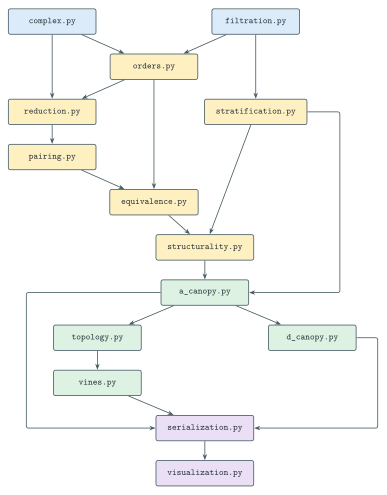

# canopytda
Python computation tools for computing Canopies.

## Data-types

We call $K$ the *fixed underlying simplicial complex*, 
which is stored as an immutable ```SimplicialComplex``` without 
filtration or embedding data.
The ```Filtration``` object specifies which filtration is being applied to the 
simplicial complex $K$, with choices ```alpha, custom, delaunay_cech, explicit, lower_star, rips```.


## Module dependencies

